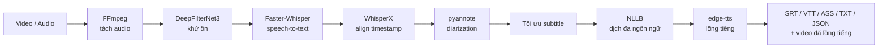

# 🎬 AI Subtitle Studio

<em>Tool cá nhân tự động tạo phụ đề &amp; lồng tiếng đa ngôn ngữ cho video, chạy 100% bằng pipeline AI mã nguồn mở trên máy có GPU.</em>

  
  
  
  
  

---

## ✨ Tính năng

- 🗣️ **Phụ đề tự động** — tách audio (FFmpeg), khử ồn (DeepFilterNet3), speech-to-text (Faster-Whisper), align timestamp (WhisperX), phân biệt người nói (pyannote diarization).
- 🌐 **Dịch đa ngôn ngữ** — NLLB-200, kèm bảng thuật ngữ riêng để giữ đúng từ chuyên ngành khi dịch.
- 🎙️ **Lồng tiếng (dubbing)** — edge-tts (giọng Neural TTS miễn phí của Microsoft), tự gán giọng khác nhau cho từng người nói, có bảng phát âm riêng cho từ viết tắt (vd. "SQL" → "ét quy eo").
- 🎨 **Tùy biến phụ đề** — chọn font/màu chữ/màu nền, kéo-thả vị trí, hardsub (ghi cứng phụ đề vào video).
- 🔊 **Xử lý âm thanh** — giữ/giảm âm lượng tiếng gốc, ducking tự động khi giọng lồng tiếng đang nói.
- 📥 **Tải video từ YouTube** — kèm cơ chế tự làm mới cookie bằng Playwright để tránh bị chặn "Sign in to confirm you're not a bot".
- 🧙 **Wizard 6 bước** — Nguồn → Giọng đọc → Dịch → Phụ đề → Âm thanh & Xuất → Xem lại, khóa tuần tự từng bước.
- 🤖 **Bot Telegram** — gửi link video qua chat, bot tự xử lý và trả kết quả qua Telegram hoặc email.
- 👤 **Web app local đầy đủ** — chạy thẳng Studio không đăng nhập, theo dõi tiến độ job theo thời gian thực và quản lý cookie/giong clone.

## 🧠 Kiến trúc pipeline

VRAM giới hạn (dev trên GPU 6GB) nên pipeline load model **tuần tự** — dùng xong bước nào giải phóng VRAM bước đó, không giữ nhiều model cùng lúc trên GPU.

## 🛠️ Công nghệ sử dụng

| Layer | Công nghệ |
|---|---|
| AI pipeline | FFmpeg · DeepFilterNet3 · Faster-Whisper · WhisperX · pyannote.audio · NLLB-200 · edge-tts |
| Backend | FastAPI · Celery · SQLAlchemy · SQLite mặc định · PostgreSQL/Redis tùy chọn |
| Frontend | React 18 · TypeScript · Vite · Tailwind CSS · TanStack Query |
| Hạ tầng dev | Docker Compose · GitHub Actions CI (Ruff + pytest + web build) |

## 💻 Yêu cầu máy chạy

Dự án chạy trên Windows 10/11 x64 với Python 3.11 x64. Python 3.11 hiện được yêu cầu vì thư viện xử lý âm thanh chưa phát hành wheel Windows cho Python 3.12. GPU NVIDIA giúp xử lý nhanh hơn nhưng không bắt buộc. Không cần cài Node.js, FFmpeg, Docker, PostgreSQL hoặc Redis bằng tay: lần đầu bấm Start Project sẽ tự chuẩn bị các phần cần thiết. Cần có Internet trong lần cài đầu và lần tải model AI.

## 🚀 Chạy ứng dụng

1. Cài Python từ [python.org](https://www.python.org/downloads/), bật tùy chọn **Add Python to PATH**.
2. Mở thư mục dự án và bấm đúp **Start Project.bat**.

Lần đầu chạy, ứng dụng sẽ tạo môi trường Python riêng, cài thư viện, tải Node.js và FFmpeg portable nếu máy chưa có, rồi tự chọn hạ tầng:

- Docker chạy được: dùng PostgreSQL và Redis trong Docker.
- Không có Docker hoặc Docker Desktop chưa khởi động được: dùng SQLite và hàng đợi công việc trong `storage/`, không cần cài hay cấu hình database server.

Sau khi trang web mở, dùng **http://localhost:5173**. Lần cài đầu có thể mất nhiều thời gian và dung lượng do thư viện AI; model sẽ tiếp tục được tải khi chạy các bước AI lần đầu.

Để dừng ứng dụng, bấm đúp **Stop Project.bat**. Dữ liệu job, file upload, kết quả và database SQLite được giữ trong `storage/`; dừng ứng dụng không xóa dữ liệu.

Người dùng chỉ cần dùng **Start Project.bat** và **Stop Project.bat**; các file
PowerShell còn lại là phần triển khai nội bộ của hai nút này.

Chế độ hạ tầng có thể chọn trong `.env`: `INFRA_MODE=auto` (mặc định), `local` (SQLite, không Docker), `docker` (bắt buộc Docker), hoặc `custom` (dùng `DATABASE_URL`/`REDIS_URL` tự cấu hình). SQLite được lưu tại `storage/app.db`, queue local tại `storage/celery.db`; cả hai không cần cài database server.

## 📚 Tài liệu

| File | Nội dung |
|---|---|
| [HANDOFF.md](HANDOFF.md) | **Đọc trước tiên** — trạng thái/tiến độ/quyết định kiến trúc mới nhất, dùng chung giữa Claude Code và Codex |
| [docs/CODE_STYLE.md](docs/CODE_STYLE.md) | Chuẩn code Python (Ruff format/lint, type hint, quy ước đặt tên) |
| [docs/memory/](docs/memory/README.md) | Bối cảnh/lý do đằng sau các quyết định kiến trúc (máy dev, quy ước HANDOFF...) |

---

Dự án cá nhân, phi thương mại — không giới hạn usage/gói cước.

